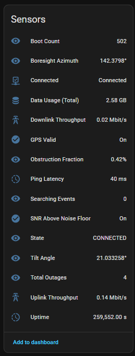
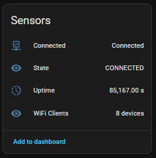

# Starlink Remote for Home Assistant

A Home Assistant integration for remote monitoring and control of Starlink hardware through the official SpaceX consumer cloud API.

[](https://github.com/hacs/integration)
[](https://github.com/clever-tour/ha-starlink-remote/actions/workflows/hacs.yml)
[](https://github.com/clever-tour/ha-starlink-remote/actions/workflows/hassfest.yml)

**Topics:** `home-assistant`, `hacs`, `integration`, `starlink`, `remote-monitoring`

> [!IMPORTANT]
> This integration is provided "as-is" and is not affiliated with, endorsed by, or supported by SpaceX or Starlink. It has been primarily tested with the **Starlink Mini (v4)**. Compatibility with older circular or rectangular dishes is expected but not guaranteed.

## Features

- **Remote access** - monitor and control your dish from anywhere; no local Starlink Wi-Fi or router access is needed.
- **Auto-discovery** - every dish and router on the account is found automatically after you paste one cookie. New hardware is picked up on the next poll.
- **Telemetry** - throughput (down/up), ping latency, obstruction fraction, orientation (boresight azimuth, tilt), uptime, boot count, searching events and outage totals.
- **Remote control** - Reboot, Stow and Unstow buttons per dish, plus Reboot for the router.
- **Self-healing authentication** - the integration keeps the browser session alive, detects a session that SpaceX has invalidated and raises a **repair issue** with a fix flow, so the new cookie can be entered right where the problem is reported.
- **Connection log while connecting** - every cookie is checked in stages and the dialog shows what happens as it happens: cookie parsed, portal session primed, account API answered, service lines and hardware discovered, integration reloaded - each line with its outcome and timing, and the verdict spelled out when something is refused.
- **Diagnostics** - one-click download (Settings > Devices & Services > Starlink Remote > Download diagnostics) with the cookie redacted.
- **Translated entities** - entity names come from the translation files, ready for other languages.

## Screenshots

| Dish sensors | Router sensors |
| :---: | :---: |
|  |  |

## Requirements

| Item | Requirement |
| --- | --- |
| Home Assistant | 2024.11 or newer |
| Account | An active Starlink consumer account (starlink.com, not the Enterprise portal) |
| Network | Outbound HTTPS to `api.starlink.com` and `www.starlink.com` |

## Installation

### Option 1: HACS (recommended)

1. Open **HACS** in your Home Assistant instance.
2. Click the three dots in the top right and select **Custom repositories**.
3. Add `https://github.com/clever-tour/ha-starlink-remote` with category `Integration`.
4. Click **Install**.
5. Restart Home Assistant.

### Option 2: Manual

1. Download the latest release.
2. Copy the `custom_components/starlink_remote` folder into your HA `config/custom_components/` directory.
3. Restart Home Assistant.

## Configuration

1. Go to **Settings > Devices & Services**.
2. Click **Add Integration** and search for **Starlink Remote**.
3. Paste your Starlink browser cookie (see below).

Only one entry per Starlink account is accepted: the account number inside the cookie is used as the unique id.

While the cookie is being checked, the dialog walks through the connection and
shows each step as it completes, so a failure tells you *where* it failed instead
of just "invalid auth":

```
### Starlink connection check

✅ Cookie parsed — 7 cookie pairs, account: 1234567 · `2 ms`
✅ Portal primed — /account/home → HTTP 200, session cookies: 4 · `310 ms`
✅ Account API answered — GET /api/webagg/v2/service-lines → HTTP 200, 1841 bytes · `180 ms`
✅ Service lines — 1 service line(s), 1 terminal(s), 1 router(s) · `0 ms`
✅ Hardware discovery — 2 device id(s): Router-A…, ut010203… · `0 ms`

**Verdict:** session is live - the account API answered with data.
```

A refused cookie ends on the same screen with the failing line marked and the
verdict spelled out (`the session is stale or was copied incompletely`), and the
same log appears for the **Configure** dialog and the repair fix flow - the latter
also re-checks that the integration reloaded and polled successfully before it
reports success.

### How to get your login cookie

1. Log in to [starlink.com/account/home](https://www.starlink.com/account/home).
2. Open the browser developer tools (`F12`) and go to the **Network** tab.
3. Reload the page.
4. Click any request to `www.starlink.com` and find the `cookie:` header in the **Request Headers** section.
5. Copy the **entire string** and paste it into the Home Assistant configuration flow.

> [!TIP]
> Use a browser other than your daily driver. Logging in to starlink.com again with the same browser rotates the session and invalidates the cookie you copied.

> [!TIP]
> If the cookie does get invalidated, you do not have to delete the integration: use the **Fix** button on the repair card (or the integration's **Configure** dialog) to paste a fresh one. Entity history is preserved either way.

## Entities

| Entity | Device | Category |
| --- | --- | --- |
| State, Uptime, Downlink/Uplink throughput, Ping latency, Obstruction fraction | Dish (and State/Uptime on the router) | - |
| Boresight azimuth, Tilt angle, Boot count, Searching events, Total outages | Dish | Diagnostic |
| WiFi clients | Router | Diagnostic |
| Connected | Router | - |
| Reboot / Stow / Unstow | Dish; Reboot also on the router | - |

Sensors are grouped under the dish and router devices that were discovered on the account, so they can be assigned to an area like any other device.

## Troubleshooting

**A repair card says the session expired.** SpaceX invalidated the cookie (usually because the account was signed in again somewhere else). Click **Fix** and paste a fresh cookie.

**Entities show `unknown` for a while.** The account API is polled on an interval (default 60 s); `unknown` on the first cycle is normal. A value that stays `unknown` forever is usually a metric the current firmware does not report - see below.

**"Data Usage (Total)" and "WiFi Clients" are always `unknown`.** These two metrics are not exposed by the API surface the integration can use. The account (webagg) service-lines payload carries no usage counter, and the router firmware (`api_version 129`) answers every client-list request with `Unimplemented`. Both entities deliberately report `unknown` rather than a wrong number, and will start reporting values by themselves if SpaceX ever exposes the data.

**Debug logging.** Add the following to `configuration.yaml` to capture a full poll cycle before opening an issue:

```yaml
logger:
  logs:
    custom_components.starlink_remote: debug
```

## Credits

Special thanks to **Eitol** for the excellent work on the [starlink-client](https://pypi.org/project/starlink-client/) library, which provided the foundational code examples and gRPC logic used to build this integration.

## Support

For help, bug reports or feature requests:

- **GitHub Issues**: [open an issue](https://github.com/clever-tour/ha-starlink-remote/issues)
- **Signal Group**: [join our community](https://signal.group/#CjQKIGdi3Eu4cjebMN6Lmno_8BikvfyduehDNeBGTXjvHt7SEhD9VRQGqufkCsp8Khz7xKzT)

## License

This integration is released under the [MIT License](LICENSE).
